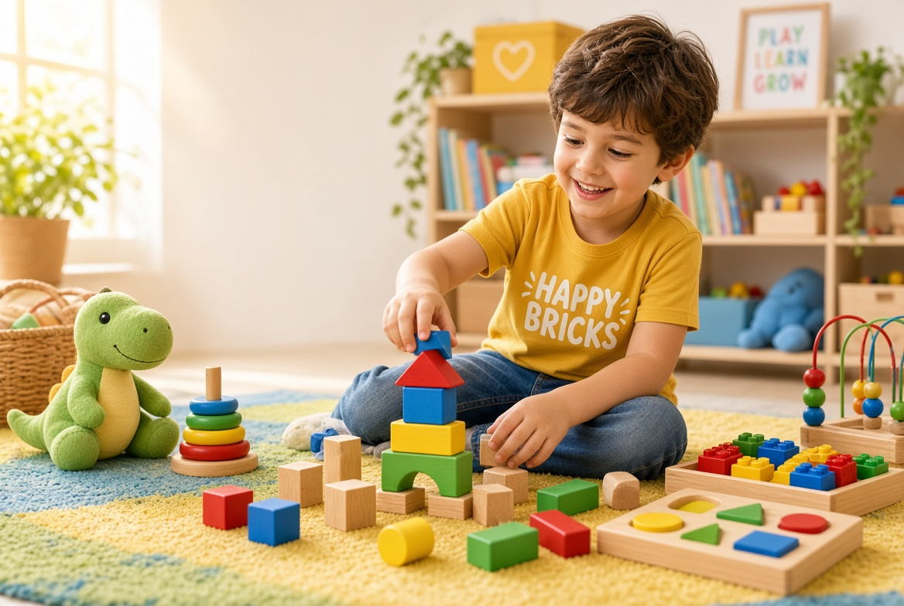
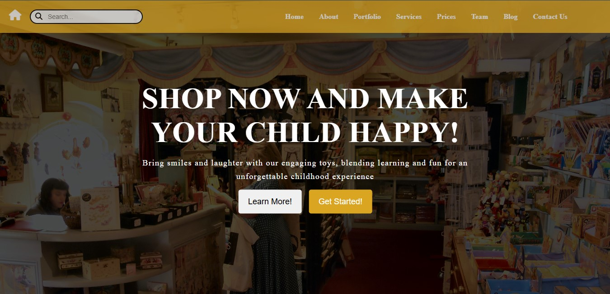

<p align="center">
  
</p>

# 🧱 Happy Bricks

A colorful, responsive online toy store website for kids, featuring toys, kids fashion, and baby essentials.

🔗 **Live Demo:** [dev-ahmedissa.github.io/happy-bricks](https://dev-ahmedissa.github.io/happy-bricks/)

## 📸 Preview



## ✨ Features

- Eye-catching hero section and clear navigation
- Product categories: educational toys, kids fashion, baby essentials
- Featured works gallery
- Pricing table for popular products
- Team and news sections
- Fully responsive layout

## 🛠️ Built With

- HTML4
- CSS2

## 🚀 Run Locally

```bash
git clone https://github.com/dev-ahmedissa/happy-bricks.git
cd happy-bricks
```

Then open `index.html` in your browser.

## 📬 Contact

**Ahmed Issa**, Frontend Developer
[ahmednashatissa@gmail.com](mailto:ahmednashatissa@gmail.com) • [GitHub](https://github.com/dev-ahmedissa)
